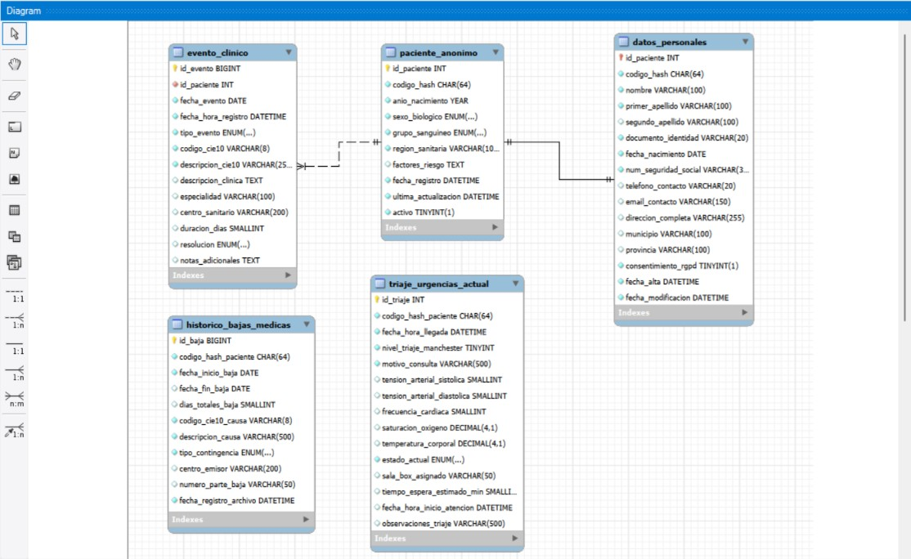

# ChronoHealthDB

**Base de datos de historiales clínicos longitudinales con anonimización desde el diseño (MySQL, XML/XQuery y MongoDB)**

*Longitudinal electronic health record database with privacy by design (MySQL 8, XML/XQuery on eXist-db and MongoDB). Course project, Biological Databases, University of Málaga (2025-26).*

🇬🇧 **English version:** [read it below](#english-version)



## Qué es

ChronoHealthDB es un sistema para guardar el historial médico completo de los pacientes durante años y, a la vez, cumplir el RGPD, que considera los datos de salud una categoría especial.

La idea central es **separar físicamente los datos clínicos de los datos personales**. Las dos partes se unen solo a través de un hash SHA-256 del documento de identidad. Así, los investigadores pueden analizar historiales completos sin ver nunca quién es el paciente, mientras que el personal clínico conserva el acceso completo desde otro esquema con sus propios permisos.

Todos los datos son **sintéticos**: los genera un script de Python con la librería Faker, así que en el repositorio no hay información de pacientes reales.

## Resultados principales

| Decisión de diseño | Resultado medido |
|---|---|
| Índices en el *join* del historial de un paciente | de 39,89 ms a 0,64 ms (62,3 veces más rápido) |
| Índices en el conteo mensual de eventos | de 46,06 ms a 1,36 ms (33,8 veces más rápido) |
| Motor ARCHIVE para el histórico de bajas | 2.560 KiB con InnoDB frente a 533 KiB con ARCHIVE (79,2 % menos) |
| Motor MEMORY para la cola de triaje de urgencias | 45,9 % menos latencia que InnoDB (0,77 ms) |
| Índice en MongoDB sobre 50.000 expedientes | COLLSCAN sustituido por IXSCAN, que examina solo 12.040 documentos |

Las cifras salen de las pruebas descritas en la memoria (`memoria/ChronoHealthDB_memoria.pdf`) y de los scripts de `mysql/medidor_tiempos.py`.

## Las tres partes del proyecto

**1. Modelo relacional (MySQL 8).** Diseño del esquema, usuarios y privilegios (rol de médico y rol de investigador), elección de un motor de almacenamiento distinto para cada tabla según su uso (InnoDB, ARCHIVE y MEMORY), generación de unos 40.000 historiales sintéticos y medición del efecto de los índices.

**2. Datos semiestructurados (XML y XQuery).** Exportación de los datos a XML, reestructuración con Python para darles una jerarquía clínica con sentido y carga en eXist-db. Tres consultas XQuery (FLWOR) funcionan como apoyo a la decisión: cruzan el riesgo de los pacientes de urgencias con sus antecedentes, detectan pacientes crónicos y generan alertas de hipoxia.

**3. NoSQL (MongoDB).** Arquitectura híbrida en la que las guías clínicas se guardan como documentos BSON y se aplican a 50.000 expedientes con *aggregation pipelines* (`$lookup`, `$bucket`, `$switch`). Se termina con una interfaz gráfica en Python (Tkinter) que delega el trabajo pesado en MongoDB.

## Estructura del repositorio

```
mysql/      esquema (Codigo-modelo.sql), usuarios y permisos, modelos de MySQL Workbench,
            generadores de datos sintéticos y script de medición de tiempos
xml/        scripts que transforman la exportación de MySQL en XML con jerarquía clínica,
            ficheros XML resultantes e informes generados con XQuery
mongodb/    generación de las guías clínicas, datos exportados en JSON y consultas de agregación
app/        interfaz gráfica del sistema de soporte a la decisión (Tkinter + PyMongo)
memoria/    memoria completa en LaTeX (y su PDF), con todas las figuras y capturas
```

## Cómo ejecutarlo

Hace falta Python 3 con `pymysql`, `faker` y `pymongo`, un servidor MySQL 8 local y, para la parte NoSQL, una base de datos MongoDB (local o en Atlas).

1. Crea el esquema ejecutando `mysql/Codigo-modelo.sql` y después `mysql/Usuarios-y-permisos.sql`.
2. Rellena la base de datos con `python mysql/generador_datos_completo.py` (ajusta antes el usuario y la contraseña de tu MySQL local al principio del script).
3. Para la parte XML, ejecuta los `transformador_*.py` desde la carpeta `xml/` y carga los ficheros resultantes en eXist-db.
4. Para la parte de MongoDB y la interfaz gráfica, define la cadena de conexión en una variable de entorno, sin escribirla nunca en el código:

```bash
export MONGODB_URI="mongodb+srv://<usuario>:<contraseña>@<tu-cluster>/"
python app/app_interfaz_ssdc.py
```

## Autores

Antonio Sánchez Doña, Aissa Omar El Hammouti Chachoui y Carlos Marín Martínez.
Trabajo de la asignatura Bases de Datos Biológicas del Grado en Ingeniería de la Salud (mención en Bioinformática), Universidad de Málaga. Tutor: Dr. Ismael Navas Delgado.

---

## English version

ChronoHealthDB is a system to store patients' full medical history over many years while complying with the GDPR, which treats health data as a special category.

The key idea is to **physically separate clinical data from personal data**. The two parts are only linked through a SHA-256 hash of the ID document. This way, researchers can analyse complete histories without ever seeing who the patient is, while clinical staff keep full access from another schema with its own permissions.

All the data are **synthetic**: a Python script generates them with the Faker library, so there is no real patient information in the repository.

### Main results

| Design decision | Measured result |
|---|---|
| Indexes on the patient history join | from 39.89 ms to 0.64 ms (62.3 times faster) |
| Indexes on the monthly event count | from 46.06 ms to 1.36 ms (33.8 times faster) |
| ARCHIVE engine for the sick leave history | 2,560 KiB with InnoDB vs 533 KiB with ARCHIVE (79.2 % less) |
| MEMORY engine for the emergency triage queue | 45.9 % lower latency than InnoDB (0.77 ms) |
| MongoDB index over 50,000 records | COLLSCAN replaced by IXSCAN, which examines only 12,040 documents |

The figures come from the tests described in the report (`memoria/ChronoHealthDB_memoria.pdf`) and from the `mysql/medidor_tiempos.py` scripts.

### The three parts of the project

**1. Relational model (MySQL 8).** Schema design, users and privileges (doctor role and researcher role), a different storage engine for each table depending on its use (InnoDB, ARCHIVE and MEMORY), generation of about 40,000 synthetic records and measurement of the effect of indexes.

**2. Semi-structured data (XML and XQuery).** Export of the data to XML, restructuring with Python to give them a meaningful clinical hierarchy, and loading into eXist-db. Three XQuery (FLWOR) queries act as decision support: they cross the risk of emergency patients with their medical history, detect chronic patients and generate hypoxia alerts.

**3. NoSQL (MongoDB).** Hybrid architecture where clinical guidelines are stored as BSON documents and applied to 50,000 records with aggregation pipelines (`$lookup`, `$bucket`, `$switch`). It ends with a Python GUI (Tkinter) that leaves the heavy work to MongoDB.

### How to run it

You need Python 3 with `pymysql`, `faker` and `pymongo`, a local MySQL 8 server and, for the NoSQL part, a MongoDB database (local or on Atlas).

1. Create the schema by running `mysql/Codigo-modelo.sql` and then `mysql/Usuarios-y-permisos.sql`.
2. Fill the database with `python mysql/generador_datos_completo.py` (first set your local MySQL user and password at the top of the script).
3. For the XML part, run the `transformador_*.py` scripts from the `xml/` folder and load the resulting files into eXist-db.
4. For MongoDB and the GUI, put the connection string in an environment variable (never in the code) and run `python app/app_interfaz_ssdc.py`.

### Authors

Antonio Sánchez Doña, Aissa Omar El Hammouti Chachoui and Carlos Marín Martínez. Project for Biological Databases in the Health Engineering degree (Bioinformatics track), University of Málaga. Supervisor: Dr. Ismael Navas Delgado.
